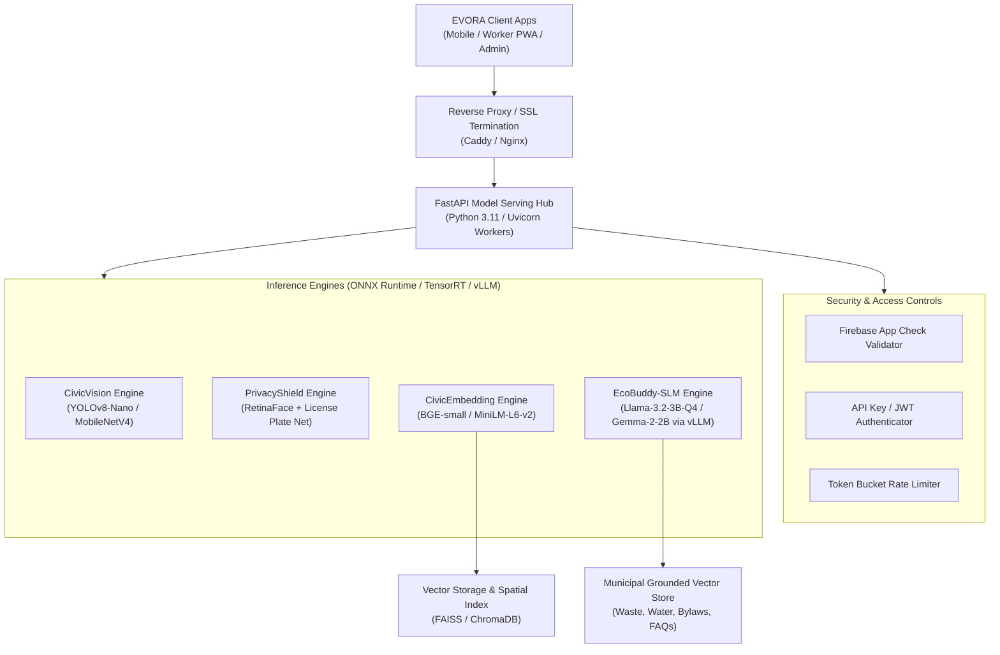
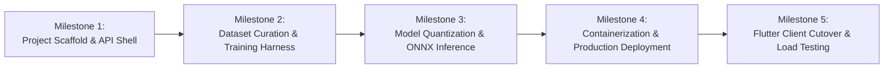

# Product Requirements Document (PRD)
## EVORA AI Engine & Custom Model Serving Pipeline

**Document Version:** 1.0.0  
**Status:** Approved for Implementation  
**Product:** EVORA Civic & Sustainability Intelligence Platform  
**Target Module:** `Evora-AI-Engine` (Microservice & Model Serving Architecture)  
**Author:** EVORA Core Architecture Team  
**Last Updated:** November 2026  

---

## 1. Executive Summary & Problem Statement

### 1.1 Context
EVORA currently utilizes cloud-hosted frontier AI models (Google Gemini Vision & Embedding APIs) for grievance triage, PII redaction, spatial duplicate detection, and conversational Eco Buddy guidance. While effective for prototyping and pilot phases, enterprise-scale municipal deployments demand:
1. **Sovereign Data Governance & DPDP Compliance:** Citizen grievance imagery and location metadata must be processed within controlled sovereign infrastructure in accordance with the Indian Digital Personal Data Protection (DPDP) Act 2023.
2. **Predictable Operational Costs:** Eliminating per-token/per-call billing from external APIs by self-hosting optimized, quantized open-source models on managed or on-premise compute.
3. **Deterministic Low Latency:** On-device or edge-accelerated inference achieving sub-100ms response times for image triage and sub-25ms for semantic vectorization, even under high civic reporting volume (e.g. monsoon storms, municipal emergencies).
4. **Air-Gapped & Offline Support:** Allowing municipal Command and Control Centers (ICCCs) and local ward servers to run grievance triage and duplicate detection without continuous external cloud internet dependencies.

### 1.2 Proposed Solution
Develop and deploy a dedicated, high-performance, containerized microservice repository (**`Evora-AI-Engine`**) that hosts custom fine-tuned, quantized neural models:
- **Engine 1 (CivicVision):** Lightweight vision detector & classifier for civic infrastructure hazards and departmental routing.
- **Engine 2 (PrivacyShield):** Automated PII detector and blur engine for faces and vehicle license plates.
- **Engine 3 (CivicEmbedding):** Compact semantic text embedder for near-duplicate grievance matching with 500m geofencing.
- **Engine 4 (EcoBuddy-SLM):** Quantized 2B-3B parameter Small Language Model with grounded Retrieval-Augmented Generation (RAG) for multilingual (English & Hindi) municipal guidance.

---

## 2. Core Objectives & Key Performance Indicators (KPIs)

### 2.1 Objectives
* Deliver an end-to-end Python microservice (`Evora-AI-Engine`) exposing production-grade REST & SSE endpoints.
* Implement a continuous dataset pipeline, model training harness, and ONNX/TensorRT quantization workflow.
* Seamlessly integrate with the existing EVORA Flutter mobile application and future Admin/Worker web consoles.
* Guarantee fallback redundancy to cloud APIs (Gemini) if the custom server is unreachable or under heavy load.

### 2.2 Success Metrics (KPIs)

| KPI Category | Target Metric | Minimum Acceptable Threshold |
| :--- | :--- | :--- |
| **Vision Classification Accuracy** | $\ge 88\%$ Top-1 accuracy across 10 civic classes | $\ge 82\%$ Top-1 accuracy |
| **Civic Detection mAP@0.5** | $\ge 0.82$ mAP on bounding-box hazard localization | $\ge 0.75$ mAP |
| **PII Redaction Recall** | $\ge 99.0\%$ on exposed faces and license plates | $\ge 96.5\%$ |
| **Embedding Retrieval (NDCG@10)** | $\ge 0.85$ on semantic duplicate pairs | $\ge 0.78$ |
| **Vision Inference Latency** | $\le 60\text{ ms}$ (GPU) / $\le 180\text{ ms}$ (CPU) | $\le 120\text{ ms}$ (GPU) / $\le 350\text{ ms}$ (CPU) |
| **Embedding Latency** | $\le 20\text{ ms}$ per 128-token grievance text | $\le 45\text{ ms}$ |
| **EcoBuddy Time to First Token (TTFT)** | $\le 1.2\text{ s}$ via streaming SSE | $\le 2.0\text{ s}$ |
| **Server Throughput** | $\ge 150\text{ requests/sec}$ on 4-core / 16GB RAM + T4/L4 GPU | $\ge 60\text{ req/sec}$ |
| **Service Availability (Uptime)** | $99.9\%$ SLA | $99.5\%$ SLA |

---

## 3. System Architecture & Model Zoo



### 3.1 Component Specifications

#### 3.1.1 Engine 1: CivicVision (Hazard Detection & Triage)
* **Architecture:** `YOLOv8n` (Nano) or `YOLOv11s` for object detection; multi-task head for categorization + severity scoring.
* **Target Classes (10 core municipal domains):**
  1. `garbage_overflow` (Solid Waste Management)
  2. `illegal_dumping` (Sanitation)
  3. `pothole` (Roads & Bridges / PWD)
  4. `open_manhole` (Drainage / Urban Safety - Critical)
  5. `waterlogging` (Stormwater & Drainage)
  6. `streetlight_broken` (Electrical & Energy)
  7. `water_pipe_leakage` (Jal Sansthan / Water Supply)
  8. `river_plastic_pollution` (River Rejuvenation & Ecology)
  9. `fallen_tree_debris` (Horticulture & Parks)
  10. `broken_pavement_curb` (Public Works Department)
* **Outputs:** Bounding boxes, primary category, confidence score ($0.0 - 1.0$), severity grade (`low`, `medium`, `high`, `urgent`), recommended lead department, and secondary support departments.

#### 3.1.2 Engine 2: PrivacyShield (PII Redaction)
* **Architecture:** Dual-cascade detector:
  1. Face Detector: Ultra-lightweight `RetinaFace-MobileNet` or `YOLOv8-Face`.
  2. License Plate Detector: Fine-tuned `YOLOv8n-LPR`.
* **Execution:** Crops detected bounding boxes with 10% safety margin and applies Gaussian blur ($\sigma = 25$) or $16\times 16$ pixelation.
* **Guarantee:** Zero raw citizen facial images or private vehicle registration numbers are saved to permanent public feeds.

#### 3.1.3 Engine 3: CivicEmbedding (Duplicate Detection)
* **Architecture:** Fine-tuned `BAAI/bge-small-en-v1.5` or `sentence-transformers/all-MiniLM-L6-v2` (quantized to INT8).
* **Dimensionality:** 384-dimensional dense float vector (or truncated/projected to 256 dimensions to match EVORA legacy vectors).
* **Pairing:** Combined with Haversine spatial distance filter ($\le 500\text{ meters}$) to flag existing open cases before submission.

#### 3.1.4 Engine 4: EcoBuddy-SLM (Civic Intelligence & RAG)
* **Architecture:** Fine-tuned Small Language Model (SLM) such as `meta-llama/Llama-3.2-3B-Instruct` or `Qwen/Qwen2.5-3B-Instruct`, 4-bit quantized (GGUF / AWQ) running on `vLLM` or `llama.cpp`.
* **Grounded RAG Pipeline:**
  - Embeds municipal solid waste manuals, segregation guides (wet/dry/domestic hazardous), local circular facilities, and Dehradun ward bylaws into a vector knowledge store.
  - Injects top-$k$ retrieved chunks into system context with zero-hallucination guardrails and emergency interceptors (gas leaks, chemical fires, electrocution risks).

---

## 4. Data Engineering & Curation Pipeline

```
Raw Data Ingestion ──> Validation & Deduplication ──> Annotation (YOLO/COCO) ──> Augmentation ──> DVC Versioning ──> Model Training
```

### 4.1 Data Sources
1. **Public Domain Datasets:**
   - TACO (Trash Annotations in Context)
   - Indian Driving Dataset (IDD) & RDD (Road Damage Dataset - Potholes/Cracks)
   - FloodNet (Waterlogging & Urban Drainage)
2. **Proprietary EVORA Pilot Data:**
   - Geotagged images collected during Dehradun pilot runs (anonymized).
3. **Synthetic Data Augmentation:**
   - Albumentations pipeline: Random shadows, intense sunlight glare, rain streaks, low-light night conditions, lens distortion.

### 4.2 Annotation Standards & Versioning
- Annotations format: Normalized bounding boxes `[class_id, x_center, y_center, width, height]` (0.0 to 1.0).
- Data Version Control: **DVC** paired with Cloud Storage bucket (`gs://evora-ml-data-registry/`).

---

## 5. Model Training, Quantization & Benchmarking Pipeline

### 5.1 Training Workflow
1. **Base Frameworks:** PyTorch 2.4+, Ultralytics, Hugging Face Transformers, Unsloth.
2. **Transfer Learning:** Pretrained weights on ImageNet/COCO, fine-tuned over 100 epochs with Early Stopping (patience: 15).
3. **Loss Functions:**
   - Vision: Combined CIoU Loss + Distribution Focal Loss + Binary Cross-Entropy.
   - Embeddings: Multiple Negatives Ranking Loss (MNRL) + Triplet Margin Loss.
   - EcoBuddy: SFT (Supervised Fine-Tuning) with LoRA ($r=16, \alpha=32$).

### 5.2 Quantization & Export Protocol
1. **PyTorch $\rightarrow$ ONNX:**
   - Export with dynamic batch size support (`--batch-size -1`).
   - Validate numerical equivalence between PyTorch fp32 and ONNX fp32 ($\Delta < 1e-4$).
2. **ONNX $\rightarrow$ INT8 / TensorRT:**
   - Calibration using representative validation dataset (500 diverse civic images).
   - Post-Training Quantization (PTQ) via ONNX Runtime Quantization tool.
3. **Model Artifact Packaging:**
   - Serialized models stored in `models/` directory with cryptographic SHA-256 integrity checksums.

---

## 6. Microservice API Specifications & Endpoints

The AI Engine microservice will run on **FastAPI** (`Python 3.11+`) inside the directory `Evora-AI-Engine`.

### 6.1 Authentication & Request Headers
* `X-API-Key`: Required server authentication token.
* `X-Firebase-AppCheck`: Optional App Check token validated in release mode.
* `X-Correlation-Id`: Distributed tracing correlation UUID.

---

### 6.2 Endpoint Contracts

#### Endpoint 1: Complete Civic Vision Analysis & Triage
* **Path:** `POST /v1/vision/analyze`
* **Content-Type:** `multipart/form-data`
* **Request:**
  - `image`: Image file binary (`image/jpeg`, `image/png`, `image/webp`, max 10MB).
  - `tenant_id`: String (e.g. `tenant_dehradun_01`).
  - `redact_pii`: Boolean (default: `true`).
* **Response (200 OK):**
```json
{
  "success": true,
  "correlation_id": "8f3b9a12-4c21-4f10-9b30-1c8a14e9f102",
  "inference_time_ms": 42.6,
  "primary_hazard": {
    "category": "garbage_overflow",
    "display_name": "Garbage Overflow / Dump",
    "confidence": 0.942,
    "severity": "high",
    "urgency_score": 3,
    "lead_department": "Solid Waste Management",
    "secondary_departments": ["Sanitation", "Health Inspection"],
    "bounding_box": [0.12, 0.34, 0.65, 0.78]
  },
  "detected_objects": [
    {
      "label": "plastic_waste",
      "confidence": 0.891,
      "bounding_box": [0.20, 0.40, 0.35, 0.55]
    }
  ],
  "pii_redaction": {
    "faces_detected": 1,
    "plates_detected": 0,
    "redaction_applied": true,
    "redacted_image_base64": "data:image/jpeg;base64,..."
  }
}
```

#### Endpoint 2: Standalone PII Redaction
* **Path:** `POST /v1/vision/redact-pii`
* **Content-Type:** `multipart/form-data`
* **Request:** Image file binary.
* **Response (200 OK):** Returns redacted image bytes with headers `X-Faces-Redacted: 2`, `X-Plates-Redacted: 1`.

#### Endpoint 3: Text Vectorization (Semantic Embeddings)
* **Path:** `POST /v1/embeddings/vectorize`
* **Content-Type:** `application/json`
* **Request Body:**
```json
{
  "text": "Huge garbage heap overflowing near Rajpur Road clock tower",
  "normalize": true
}
```
* **Response (200 OK):**
```json
{
  "success": true,
  "dimensions": 384,
  "embedding": [0.0241, -0.0492, 0.1102, "...(384 floats)..."],
  "inference_time_ms": 8.3
}
```

#### Endpoint 4: Duplicate Grievance Spatial & Semantic Check
* **Path:** `POST /v1/duplicate/check`
* **Content-Type:** `application/json`
* **Request Body:**
```json
{
  "tenant_id": "tenant_dehradun_01",
  "latitude": 30.3165,
  "longitude": 78.0322,
  "category": "garbage_overflow",
  "text": "Garbage pile spilling onto road",
  "radius_km": 0.5,
  "similarity_threshold": 0.78
}
```
* **Response (200 OK):**
```json
{
  "is_duplicate_detected": true,
  "highest_similarity": 0.874,
  "matching_case": {
    "case_id": "CF-2026-0042",
    "distance_meters": 142.5,
    "status": "in_progress",
    "reported_at": "2026-11-16T14:30:00Z"
  }
}
```

#### Endpoint 5: Eco Buddy Conversational Assistant (SSE Streaming)
* **Path:** `POST /v1/chat/completions`
* **Content-Type:** `application/json`
* **Headers:** `Accept: text/event-stream`
* **Request Body:**
```json
{
  "messages": [
    {"role": "user", "content": "How do I dispose of old laptop batteries in Dehradun?"}
  ],
  "preferred_language": "en",
  "tenant_id": "tenant_dehradun_01",
  "stream": true
}
```
* **Response:** Server-Sent Events stream delivering incremental markdown tokens grounded in verified local e-waste circular facilities.

#### Endpoint 6: Service Health & Diagnostics
* **Path:** `GET /v1/health`
* **Response (200 OK):**
```json
{
  "status": "healthy",
  "version": "1.0.0",
  "uptime_seconds": 184520,
  "gpu_available": true,
  "gpu_device": "NVIDIA L4",
  "models_loaded": {
    "civic_vision": "yolov8s-civic-int8.onnx",
    "privacy_shield": "retinaface-pii-fp16.onnx",
    "civic_embedder": "bge-small-civic-int8.onnx"
  }
}
```

---

## 7. Security, Privacy & DPDP Compliance

1. **In-Memory Ephemeral Processing:**
   - Raw user images processed in RAM without writing unredacted copies to server temp disks.
2. **Network Transport Security:**
   - Enforce TLS 1.3 with strict modern cipher suites (`TLS_AES_256_GCM_SHA384`).
   - Pinned public key fingerprints matching EVORA's `CertificatePinningService`.
3. **Rate Limiting & Abuse Prevention:**
   - Max 30 vision inference requests per minute per IP/API token.
   - Max 60 embedding requests per minute.
   - Excessive burst throttling with HTTP `429 Too Many Requests`.
4. **Audit Logging:**
   - Log transaction timestamps, correlation IDs, model latency, and token counts.
   - Zero storage of citizen personal identifiable information (PII) in application logs.

---

## 8. Infrastructure, Containerization & Deployment Pipeline


### 8.1 Docker Container Strategy
A multi-stage `Dockerfile` will be provided:
- **Build Stage:** Installs build utilities, compilers, and downloads base model weights.
- **Runtime Stage (CPU target):** `python:3.11-slim` with `onnxruntime` optimized for Intel/AMD AVX-512 instruction sets (under 500MB final image size).
- **Runtime Stage (GPU target):** `nvidia/cuda:12.2.0-base-ubuntu22.04` with `onnxruntime-gpu` and TensorRT drivers.

### 8.2 Docker Compose Stack
```yaml
services:
  evora-ai:
    image: evora-ai-engine:latest
    restart: unless-stopped
    ports:
      - "8000:8000"
    environment:
      - MODEL_ENV=production
      - API_KEY=${AI_ENGINE_API_KEY}
    volumes:
      - ./models:/app/models:ro
  
  caddy:
    image: caddy:2-alpine
    restart: unless-stopped
    ports:
      - "80:80"
      - "443:443"
    volumes:
      - ./Caddyfile:/etc/caddy/Caddyfile
      - caddy_data:/data
```

---

## 9. Phased Implementation Roadmap



### Phase Breakdown

* **Milestone 1: Repository Scaffolding & API Microservice**
  - Initialize dedicated directory: `/Evora-AI-Engine`.
  - Set up Python project structure, virtual environment (`pyproject.toml` / `requirements.txt`), FastAPI application, Pydantic data schemas, routers, and mock test harness.

* **Milestone 2: Training Pipelines & Dataset Curation**
  - Implement dataset downloaders and annotation conversion utilities.
  - Implement training scripts for `CivicVision` (YOLO) and `CivicEmbedding` (SentenceTransformers).
  - Train baseline models and evaluate mAP and loss curves.

* **Milestone 3: Model Optimization & ONNX Runtime Integration**
  - Export models to ONNX and perform INT8 calibration.
  - Implement `ModelManager` class in FastAPI to load models into memory on startup with zero inference lock contention.
  - Wire PII auto-blur post-processing into vision pipeline.

* **Milestone 4: Containerization, Security & Production Deployment**
  - Write multi-stage `Dockerfile` and `docker-compose.yml` with Caddy automatic TLS.
  - Add API key authentication, rate limiting, and health probes.
  - Deploy to target server or container cloud.

* **Milestone 5: Flutter Client Integration & Verification**
  - Configure `AppConstants.dart` with custom AI server URL.
  - Update `secure_http_client.dart` with dedicated SSL certificate fingerprint.
  - Implement seamless client fallback to Google Gemini when custom server is offline.
  - Execute end-to-end integration tests and load tests (100 concurrent users).

---

## 10. Risk Assessment & Mitigation Matrix

| Risk | Impact | Likelihood | Mitigation Strategy |
| :--- | :--- | :--- | :--- |
| **High GPU Cloud Costs** | High | Medium | Build with CPU-first ONNX INT8 quantization. On a modern multi-core CPU, YOLOv8n and MiniLM run in under 80ms, eliminating the immediate need for costly dedicated GPUs. |
| **Edge Case Misclassifications** | Medium | High | Implement human-in-the-loop review on municipal admin dashboard; allow citizens to manually adjust AI-suggested category before submitting. |
| **AI Server Downtime / Outage** | High | Low | The Flutter client retains an automatic client-side fallback to the Google Gemini API if the dedicated AI server fails health checks. |
| **Model Drift over Seasons** | Low | Medium | Schedule bi-monthly dataset retraining with newly resolved ground-truth civic cases from the database. |

---

## 11. Approval & Sign-Off

This PRD establishes the technical blueprint and development criteria for the EVORA AI Engine. Upon final review, development begins with **Milestone 1** (scaffolding the `/Evora-AI-Engine` microservice).
